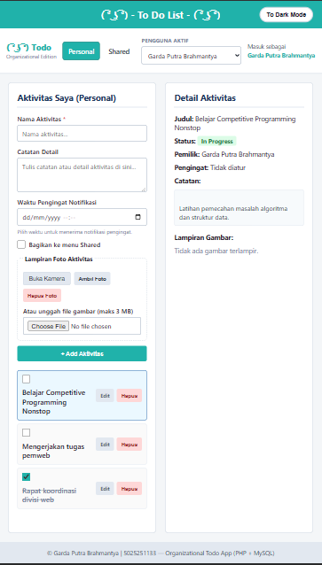
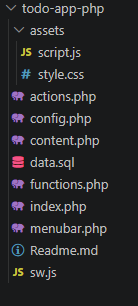
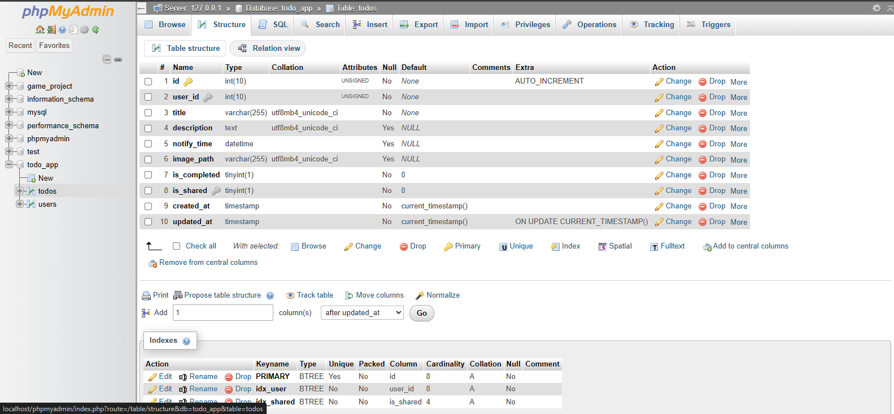
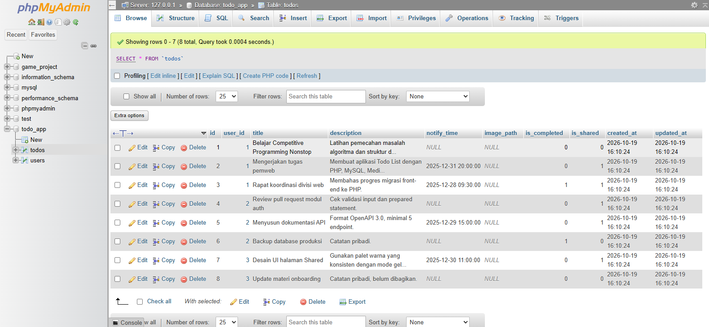
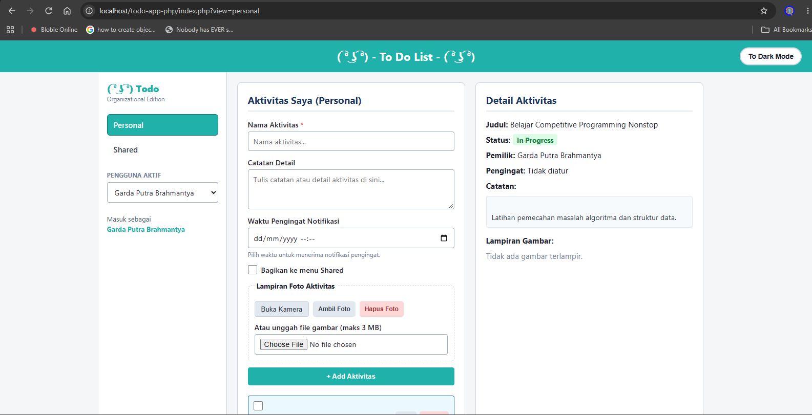
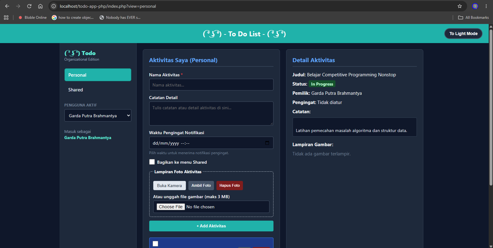
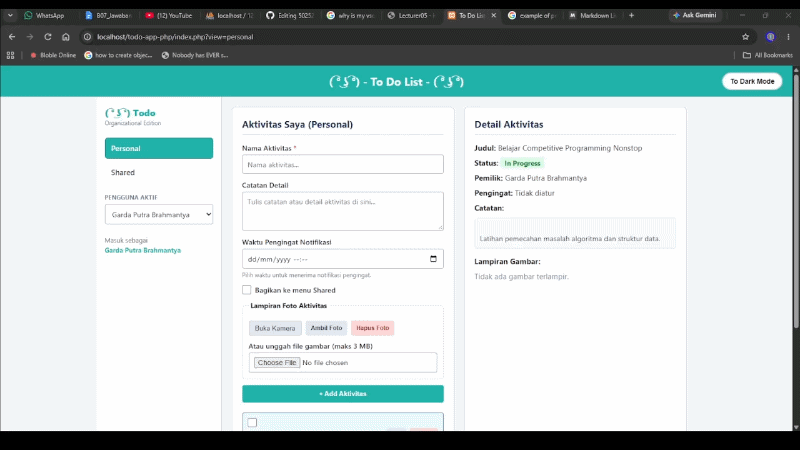
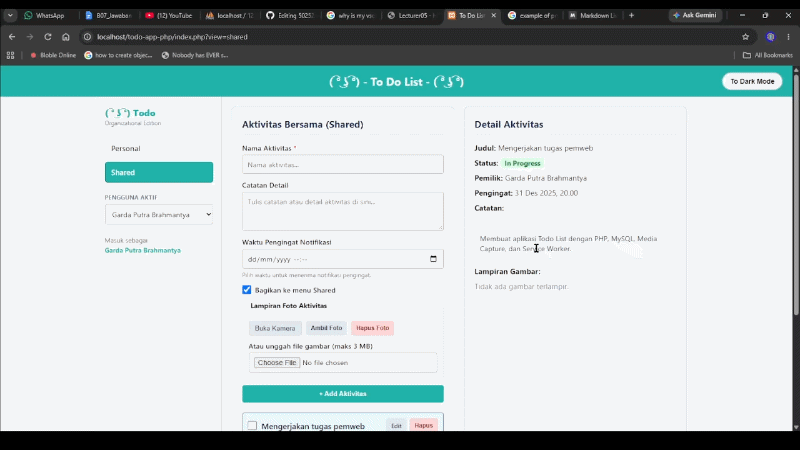
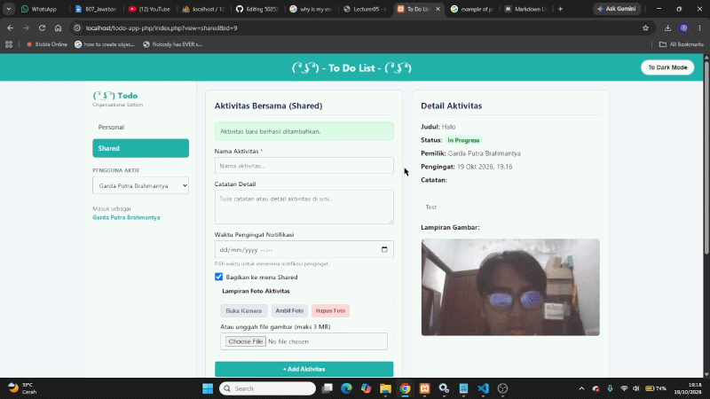
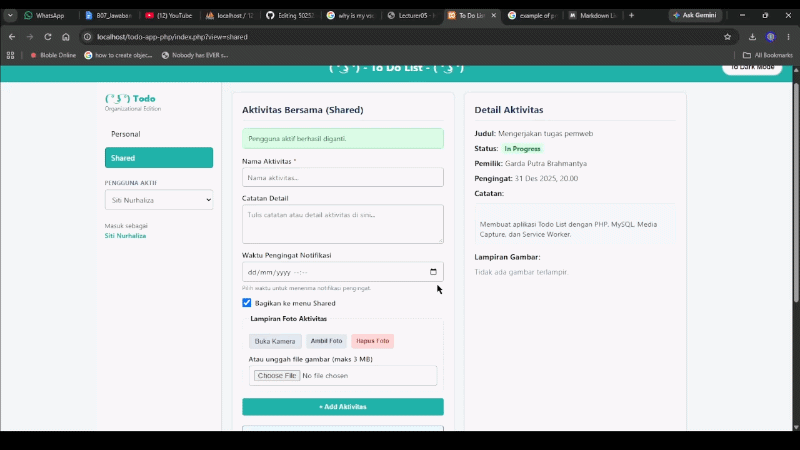

# 5025251133_Todo-App  Organizational Todo App

## Identitas
- **Nama** : Garda Putra Brahmantya
- **NRP** : 5025251133
- **Kelas** : Pemrograman Web - A

---

## Ringkasan Evolusi Proyek

Aplikasi Todo List dikembangkan melalui **dua tahap**:

| Tahap | Fokus | Stack | Hasil |
|-------|-------|-------|-------|
| **E03  The Lost Cavern** | Client-side modern (PWA) | HTML + CSS + Vanilla JS + IndexedDB + SW | Personal todo app persisten di browser |
| **Iron Citadel** | Server-side organizational | PHP 8 + MySQL + PDO | Multi-user todo app dengan menu **Personal** & **Shared** |

Versi final = **PHP + MySQL**  semua fitur JS (dark mode, camera, notifications, service worker, a11y) **tetap dipertahankan** dan dipadukan dengan CRUD server-side, session-based multi-user, dan file handling PHP.

---

## Fitur Utama

### Fungsional
- **Sidebar navigasi** menu **Personal** / **Shared** + **user switcher**.
- **CRUD lengkap via PHP** dengan pola Post/Redirect/Get (PRG).
- **Multi-user**: ganti user aktif dari sidebar → list Personal & hak akses berubah.
- **Shared view**: menampilkan todo `is_shared = 1` dari **semua user**, dengan badge pemilik.
- **Otorisasi server-side**: hanya pemilik bisa Edit/Hapus; user lain hanya bisa toggle status todo Shared.
- **File handling PHP**:
  - Upload berkas via `<input type="file">` (`move_uploaded_file` + `finfo` MIME validation).
  - Upload gambar dari kamera via base64 data URL (`file_put_contents`).
  - **File dihapus otomatis** saat todo dihapus.
- **Kamera Media Capture** (`getUserMedia` + `<canvas>`).
- **Waktu pengingat notifikasi** (`datetime-local`) + **Notification API**.
- **Service Worker**: caching offline aset statis + klik notifikasi.
- **Dark Mode persisten** via `localStorage`.

### Aksesibilitas (A11y)
- Landmark ARIA (`banner`, `main`, `contentinfo`).
- `aria-labelledby` panel ↔ heading.
- `aria-current="page"` pada menu aktif.
- `aria-live="polite"` detail panel + `srAnnouncement`.
- `role="status"` status completed/in-progress.
- `:focus-visible` outline tegas.
- Keyboard nav penuh.

---

## Struktur File

```text
todo-app-php/
├── index.php          # Bootstrap + routing + render
├── config.php         # PDO, session, konstanta upload
├── functions.php      # Seluruh CRUD & helper
├── actions.php        # Handler POST
├── menubar.php        # Sidebar (Personal/Shared + user switcher)
├── content.php        # Panel kiri (form+list) & kanan (detail/edit)
├── data.sql           # DDL + dummy data
├── sw.js              # Service Worker
├── README.md
├── assets/
│   ├── style.css
│   ├── script.js
│   └── (gambar/gif demo)
└── uploads/           # File gambar; auto-created
```

---

## Struktur Database

**Database**: `todo_app` (MySQL/MariaDB, `utf8mb4_unicode_ci`)

### `users`
| Kolom | Tipe | Keterangan |
|-------|------|-----------|
| `id` | INT UNSIGNED PK AI | ID user |
| `username` | VARCHAR(50) UNIQUE | Login key |
| `display_name` | VARCHAR(100) | Nama tampilan |
| `created_at` | TIMESTAMP | Auto |

### `todos`
| Kolom | Tipe | Keterangan |
|-------|------|-----------|
| `id` | INT UNSIGNED PK AI | ID todo |
| `user_id` | INT UNSIGNED FK→users.id (CASCADE) | Pemilik |
| `title` | VARCHAR(255) | Judul |
| `description` | TEXT NULL | Catatan |
| `notify_time` | DATETIME NULL | Pengingat |
| `image_path` | VARCHAR(255) NULL | Path relatif (`uploads/xxx.jpg`) |
| `is_completed` | TINYINT(1) | 0/1 |
| `is_shared` | TINYINT(1) | 0=Personal, 1=Shared |
| `created_at` / `updated_at` | TIMESTAMP | Auto |

**Dummy data**: 3 user (`garda`, `budi`, `siti`) + 8 todo (campuran personal & shared, ada `notify_time`).

---

## Cara Menjalankan

### XAMPP (Direkomendasikan)
1. **Start Apache + MySQL** di XAMPP Control Panel.
2. Salin folder proyek ke `C:\xampp\htdocs\todo-app-php\`.
3. `http://localhost/phpmyadmin/` → tab **Import** → pilih `data.sql` → **Go**.
4. Pastikan `config.php` cocok (default `root` / password kosong).
5. Buka **`http://localhost/todo-app-php/`**.
6. Izinkan kamera & notifikasi saat diminta.

### PHP Built-in
```bash
cd todo-app-php && php -S localhost:8000
```

>  **Harus via `localhost`**  kamera, Service Worker, Notification API butuh secure context.

---

## Penjelasan Kode per File (Detail)

### 1. `config.php`

**Tujuan**: Pusat koneksi database, session, konstitusi upload, dan helper escape.

**Snippet kunci**:
```php
define('UPLOAD_DIR', __DIR__ . '/uploads/');
define('UPLOAD_URL', 'uploads/');
define('MAX_UPLOAD_BYTES', 3 * 1024 * 1024); // 3 MB

$pdo = new PDO(
    'mysql:host=' . DB_HOST . ';dbname=' . DB_NAME . ';charset=utf8mb4',
    DB_USER, DB_PASS,
    [
        PDO::ATTR_ERRMODE            => PDO::ERRMODE_EXCEPTION,
        PDO::ATTR_DEFAULT_FETCH_MODE => PDO::FETCH_ASSOC,
        PDO::ATTR_EMULATE_PREPARES   => false,   // ← prepared statement ASLI
    ]
);

function e($value): string {
    return htmlspecialchars((string) $value, ENT_QUOTES, 'UTF-8');
}
```

**Yang diperbarui dari E03**:
| Aspek | E03 | Sekarang |
|-------|-----|----------|
| Koneksi data | IndexedDB (browser) | **PDO ke MySQL** |
| Config terpusat | ✘ (inline di `script.js`) | ✔ `config.php` di-include tiap request |
| Escape output | `textContent`/`setAttribute` | `e()` = `htmlspecialchars` **eksplisit** |

**Catatan keamanan**:
- `EMULATE_PREPARES => false` → prepared statement murni (bukan string escape).
- `ERRMODE_EXCEPTION` → error ditangkap sebagai exception.
- `UPLOAD_DIR` pakai `__DIR__` → portabel (tidak bergantung CWD Apache).

---

### 2. `data.sql`

**Tujuan**: DDL + dummy data siap import.

**Snippet DDL**:
```sql
CREATE TABLE todos (
  id           INT UNSIGNED AUTO_INCREMENT PRIMARY KEY,
  user_id      INT UNSIGNED NOT NULL,
  title        VARCHAR(255) NOT NULL,
  description  TEXT NULL,
  notify_time  DATETIME NULL,
  image_path   VARCHAR(255) NULL,
  is_completed TINYINT(1) NOT NULL DEFAULT 0,
  is_shared    TINYINT(1) NOT NULL DEFAULT 0,
  created_at   TIMESTAMP DEFAULT CURRENT_TIMESTAMP,
  updated_at   TIMESTAMP DEFAULT CURRENT_TIMESTAMP ON UPDATE CURRENT_TIMESTAMP,
  CONSTRAINT fk_todos_user FOREIGN KEY (user_id) REFERENCES users(id) ON DELETE CASCADE,
  INDEX idx_user (user_id),
  INDEX idx_shared (is_shared)
) ENGINE=InnoDB;
```

**Snippet dummy data**:
```sql
INSERT INTO todos (user_id, title, description, notify_time, image_path, is_completed, is_shared) VALUES
  (1, 'Mengerjakan tugas pemweb',
      'Membuat aplikasi Todo List dengan PHP, MySQL, Media Capture...',
      '2025-12-31 20:00:00', NULL, 0, 1),   -- ↑ shared oleh Garda
  (2, 'Review pull request modul auth',
      'Cek validasi input dan prepared statement.',
      NULL, NULL, 0, 1),                    -- ↑ shared oleh Budi
  (3, 'Update materi onboarding',
      'Catatan pribadi, belum dibagikan.',
      NULL, NULL, 0, 0);                    -- ↑ personal Siti
```

**Yang diperbarui dari E03**:
| Aspek | E03 (`defaultTodos` di JS) | Sekarang (`data.sql`) |
|-------|---------------------------|-----------------------|
| Tipe data | JS object array | **Tabel relasional** |
| Relasi | ✘ | ✔ `user_id` FK ke `users` |
| Field baru |  | `is_shared`, `user_id`, `updated_at` |
| Index |  | `idx_user`, `idx_shared` (perf) |
| Cascade delete | Manual JS filter | ✔ `ON DELETE CASCADE` |

---

### 3. `functions.php`

**Tujuan**: Semua logika CRUD & helper (single source of truth).

#### 3.1. READ  `getTodos()`

```php
function getTodos(PDO $pdo, int $userId, string $view): array
{
    $order = "ORDER BY t.is_completed ASC, t.created_at DESC";

    if ($view === 'shared') {
        // Semua todo yang dibagikan oleh SEMUA user
        $sql = "SELECT t.*, u.display_name AS owner_name
                FROM todos t JOIN users u ON u.id = t.user_id
                WHERE t.is_shared = 1
                $order";
        return $pdo->query($sql)->fetchAll();
    }

    // Personal = todo milik user aktif
    $sql = "SELECT t.*, u.display_name AS owner_name
            FROM todos t JOIN users u ON u.id = t.user_id
            WHERE t.user_id = ? $order";
    $stmt = $pdo->prepare($sql);
    $stmt->execute([$userId]);
    return $stmt->fetchAll();
}
```

- **JOIN ke `users`** → badge `owner_name` (khusus view Shared).
- **Prepared statement** untuk Personal (`user_id = ?`) → aman dari injection.
- Ordering: yang belum selesai di atas, yang baru dibuat dulu.

#### 3.2. CREATE  `createTodo()`

```php
function createTodo(PDO $pdo, int $userId, string $title, string $desc,
                    ?string $notify, ?string $imagePath, int $isShared): int
{
    $stmt = $pdo->prepare(
        "INSERT INTO todos (user_id, title, description, notify_time, image_path, is_shared)
         VALUES (?, ?, ?, ?, ?, ?)"
    );
    $stmt->execute([$userId, $title, $desc, $notify, $imagePath, $isShared]);
    return (int) $pdo->lastInsertId();
}
```

Mengembalikan `lastInsertId()` untuk redirect `?id=N` setelah submit.

#### 3.3. UPDATE  `updateTodo()` & `toggleTodo()`

```php
function updateTodo(PDO $pdo, int $id, array $data): void
{
    $stmt = $pdo->prepare(
        "UPDATE todos
         SET title = ?, description = ?, notify_time = ?, is_completed = ?, is_shared = ?
         WHERE id = ?"
    );
    $stmt->execute([...$data, $id]);
}

function toggleTodo(PDO $pdo, int $id): void
{
    // Toggle numerik: 1 - is_completed
    $pdo->prepare("UPDATE todos SET is_completed = 1 - is_completed WHERE id = ?")
        ->execute([$id]);
}
```

`toggleTodo()` memakai trick **`1 - is_completed`** → tidak perlu SELECT dulu.

#### 3.4. DELETE  `deleteTodoWithImage()`

```php
function deleteTodoWithImage(PDO $pdo, int $id): void
{
    $todo = getTodoById($pdo, $id);
    if ($todo && !empty($todo['image_path'])) {
        $file = __DIR__ . '/' . $todo['image_path'];
        if (is_file($file)) {
            @unlink($file);        // ← hapus file fisik juga
        }
    }
    $pdo->prepare("DELETE FROM todos WHERE id = ?")->execute([$id]);
}
```

**Kriteria #5 (File Handling)** terlihat jelas di sini: hapus DB row → **file ikut terhapus**.

#### 3.5. File Handling  `handleImageUpload()`

```php
function handleImageUpload(): ?string
{
    /* ---- (1) Upload berkas biasa ---- */
    if (!empty($_FILES['image_file']['tmp_name'])
        && is_uploaded_file($_FILES['image_file']['tmp_name'])) {
        $tmp  = $_FILES['image_file']['tmp_name'];
        $size = (int) ($_FILES['image_file']['size'] ?? 0);

        $allowed = ['image/jpeg' => 'jpg', 'image/png' => 'png', 'image/webp' => 'webp'];

        $finfo = new finfo(FILEINFO_MIME_TYPE);
        $mime  = $finfo->file($tmp);           // ← validasi MIME asli

        if (isset($allowed[$mime]) && $size > 0 && $size <= MAX_UPLOAD_BYTES) {
            $filename = 'todo_' . uniqid('', true) . '.' . $allowed[$mime];
            if (move_uploaded_file($tmp, UPLOAD_DIR . $filename)) {
                return UPLOAD_URL . $filename;
            }
        }
    }

    /* ---- (2) Data URL dari kamera (base64) ---- */
    $dataUrl = $_POST['image_data'] ?? '';
    if (preg_match('#^data:image/(jpeg|png|webp);base64,#', $dataUrl, $m)) {
        $payload = substr($dataUrl, strpos($dataUrl, ',') + 1);
        $binary  = base64_decode($payload, true);

        if ($binary !== false && strlen($binary) <= MAX_UPLOAD_BYTES) {
            $filename = 'todo_' . uniqid('', true) . '.' . $m[1];
            if (file_put_contents(UPLOAD_DIR . $filename, $binary) !== false) {
                return UPLOAD_URL . $filename;
            }
        }
    }

    return null;
}
```

**Dua jalur input**  bukti kuat kriteria #5:

| Sumber | Fungsi PHP | Validasi |
|--------|-----------|----------|
| Upload berkas | `move_uploaded_file` | `finfo` MIME + size |
| Kamera | `file_put_contents` (base64 decode) | regex MIME + size |

**Praktik terbaik**:
- `is_uploaded_file()` mencegah spoofing.
- MIME type **bukan** ekstensi (mencegah `.jpg` yang isinya PHP).
- Filename random (`uniqid`) mencegah overwrite.
- Batas `MAX_UPLOAD_BYTES` di sisi PHP (di samping `upload_max_filesize` di `php.ini`).

#### 3.6. Helpers

```php
function normalizeDateTime(?string $v): ?string { /* T → spasi, validasi strtotime */ }
function formatNotify(?string $dt): string     { /* id-ID: "31 Des 2025, 20.00" */ }
function flash(string $m, string $t='success'): void { $_SESSION['flash'] = [...]; }
function getFlash(): ?array                    { /* pop dari session */ }
```

- `normalizeDateTime`: `<input type="datetime-local">` menghasilkan `2025-12-31T20:00` → konversi ke format MySQL.
- `flash`/`getFlash`: pesan sukses/error antar request (PRG).

---

### 4. `actions.php`

**Tujuan**: Handler POST tunggal (semua mutasi masuk sini). Di-include **sebelum** HTML output.

**Snippet dispatcher**:
```php
if (($_SERVER['REQUEST_METHOD'] ?? '') !== 'POST') return;

$action   = $_POST['action'] ?? '';
$view     = in_array($_POST['view'] ?? '', ['personal','shared'], true) ? $_POST['view'] : 'personal';
$redirect = 'index.php?view=' . $view;

switch ($action) {
    case 'switch_user': ...
    case 'add':         ...
    case 'update':      ...
    case 'delete':      ...
    case 'toggle':      ...
}

header('Location: ' . $redirect);
exit;
```

#### 4.1. `switch_user`  session user aktif

```php
case 'switch_user':
    $uid = (int) ($_POST['user_id'] ?? 0);
    if ($uid > 0) {
        $stmt = $pdo->prepare("SELECT id FROM users WHERE id = ?");
        $stmt->execute([$uid]);
        if ($stmt->fetch()) {               // ← validasi user exists
            $_SESSION['user_id'] = $uid;
            flash('Pengguna aktif berhasil diganti.');
        }
    }
    header('Location: index.php?view=' . $view);
    exit;
```

#### 4.2. `add`  Create

```php
case 'add':
    $title  = trim($_POST['title'] ?? '');
    if ($title === '') {                    // ← validasi server-side
        flash('Judul aktivitas wajib diisi.', 'error');
        break;
    }
    $imagePath = handleImageUpload();       // ← file handling
    $newId = createTodo($pdo, $currentUserId, $title,
                        trim($_POST['description'] ?? ''),
                        normalizeDateTime($_POST['notify_time'] ?? null),
                        $imagePath,
                        isset($_POST['is_shared']) ? 1 : 0);
    flash('Aktivitas baru berhasil ditambahkan.');
    $redirect .= '&id=' . $newId;
    break;
```

#### 4.3. `update`  Otorisasi + Update

```php
case 'update':
    $todo = getTodoById($pdo, (int)($_POST['id'] ?? 0));
    if (!$todo) { flash('Aktivitas tidak ditemukan.', 'error'); break; }

    // ← OTORISASI: hanya pemilik yang boleh update
    if ((int) $todo['user_id'] !== $currentUserId) {
        flash('Anda tidak berhak mengubah aktivitas ini.', 'error');
        $redirect .= '&id=' . $todo['id'];
        break;
    }
    updateTodo($pdo, $todo['id'], [
        'title'        => trim($_POST['title'] ?? ''),
        'description'  => trim($_POST['description'] ?? ''),
        'notify_time'  => normalizeDateTime($_POST['notify_time'] ?? null),
        'is_completed' => ($_POST['is_completed'] ?? '0') === '1' ? 1 : 0,
        'is_shared'    => isset($_POST['is_shared']) ? 1 : 0,
    ]);
    break;
```

#### 4.4. `delete`  Otorisasi + File cleanup

```php
case 'delete':
    $todo = getTodoById($pdo, (int)($_POST['id'] ?? 0));
    if (!$todo || (int)$todo['user_id'] !== $currentUserId) {
        flash('Anda tidak berhak menghapus aktivitas ini.', 'error');
        break;
    }
    deleteTodoWithImage($pdo, $todo['id']);  // ← DB + file terhapus
    flash('Aktivitas berhasil dihapus.');
    break;
```

#### 4.5. `toggle`  Aturan khusus Shared

```php
case 'toggle':
    $todo = getTodoById($pdo, (int)($_POST['id'] ?? 0));
    if ($todo) {
        $isOwner  = (int) $todo['user_id']   === $currentUserId;
        $isShared = (int) $todo['is_shared'] === 1;

        // Pemilik bebas toggle; user lain hanya boleh toggle todo SHARED
        if ($isOwner || $isShared) {
            toggleTodo($pdo, $todo['id']);
            flash('Status aktivitas diperbarui.');
        } else {
            flash('Anda tidak berhak mengubah aktivitas ini.', 'error');
        }
        $redirect .= '&id=' . $todo['id'];
    }
    break;
```

**Perbedaan penting** dari `update`/`delete`: **`toggle` memperbolehkan user lain** untuk mengubah status todo Shared. Ini adalah **keputusan desain organisasi** (kolaboratif), bukan bug.

---

### 5. `index.php`

**Tujuan**: Controller + View utama. Menggabungkan semua partial.

**Snippet routing**:
```php
require_once __DIR__ . '/config.php';
require_once __DIR__ . '/functions.php';
require_once __DIR__ . '/actions.php';      // ← POST handler dipanggil dulu

$view = $_GET['view'] ?? 'personal';
if (!in_array($view, ['personal','shared'], true)) $view = 'personal';

$users       = getUsers($pdo);
$currentUser = getCurrentUser($pdo, $currentUserId);
$todos       = getTodos($pdo, $currentUserId, $view);

// Pilih ID aktif dari GET, fallback ke todos[0]
$selectedId = isset($_GET['id']) ? (int)$_GET['id'] : null;
if ($selectedId === null || !in_array($selectedId, array_column($todos,'id'))) {
    $selectedId = $todos[0]['id'] ?? null;
}
$editMode = isset($_GET['edit']) && $selectedTodo && owner-only;
```

**Snippet JSON bridge ke JS** (untuk notifikasi):
```php
<script>
  window.__TODOS__ = <?= json_encode($todosForJs,
      JSON_HEX_TAG | JSON_HEX_AMP | JSON_HEX_APOS | JSON_HEX_QUOT) ?>;
</script>
```

**Yang diperbarui dari E03**:
| Aspek | E03 | Sekarang |
|-------|-----|----------|
| Routing | ✘ SPA single page | ✔ `?view=…&id=…&edit=1` |
| State | Global JS vars | `$_GET` + session + DB |
| JSON bridging | Semua data di IndexedDB | **Bridge PHP → JS** hanya field notifikasi |

---

### 6. `menubar.php`  **Kriteria #1**

**Tujuan**: Sidebar dengan dua menu utama + user switcher.

**Snippet menu**:
```php
<nav aria-label="Menu Utama">
  <ul class="menu-list">
    <li>
      <a class="menu-link <?= $view === 'personal' ? 'active' : '' ?>"
         href="index.php?view=personal"
         <?= $view === 'personal' ? 'aria-current="page"' : '' ?>>
        Personal
      </a>
    </li>
    <li>
      <a class="menu-link <?= $view === 'shared' ? 'active' : '' ?>"
         href="index.php?view=shared"
         <?= $view === 'shared' ? 'aria-current="page"' : '' ?>>
        Shared
      </a>
    </li>
  </ul>
</nav>
```

**Snippet user switcher**:
```php
<form method="post" action="index.php" class="user-switcher">
  <input type="hidden" name="action" value="switch_user">
  <input type="hidden" name="view" value="<?= e($view) ?>">
  <label for="userSelect">Pengguna Aktif</label>
  <select id="userSelect" name="user_id" onchange="this.form.submit()">
    <?php foreach ($users as $u): ?>
      <option value="<?= (int)$u['id'] ?>" <?= $u['id']==$currentUserId?'selected':'' ?>>
        <?= e($u['display_name']) ?>
      </option>
    <?php endforeach; ?>
  </select>
  <noscript><button type="submit" class="btn-secondary">Ganti Pengguna</button></noscript>
</form>
```

- **`onchange="this.form.submit()"`** → ganti user langsung via POST (tanpa JS kompleks).
- **`<noscript>` fallback** → tetap berfungsi tanpa JS.

**Yang diperbarui dari E03**:
| Aspek | E03 | Sekarang |
|-------|-----|----------|
| Menu | ✘ (single view) | ✔ **Personal / Shared** |
| Multi-user | ✘ | ✔ **User switcher** |
| A11y |  | ✔ `aria-label`, `aria-current` |

---

### 7. `content.php`  **Kriteria #4 & #5**

**Tujuan**: Panel kiri (form + list) + panel kanan (detail/edit).

#### 7.1. Form tambah  `enctype multipart`

```php
<form id="todoForm" method="post" action="index.php"
      enctype="multipart/form-data" class="form-todo"
      aria-label="Form Tambah Aktivitas Baru">

  <input type="hidden" name="action" value="add">
  <input type="hidden" name="view" value="<?= e($view) ?>">
  <input type="hidden" name="image_data" id="imageData" value="">
  <!-- ↑ diisi base64 oleh JS kamera -->
  ...
  <fieldset class="camera-section">
    <legend>Lampiran Foto Aktivitas</legend>
    <video id="cameraVideo" autoplay playsinline hidden></video>
    <canvas id="cameraCanvas" hidden></canvas>
    
    <!-- tombol Buka Kamera / Ambil / Hapus -->
    <input type="file" id="todoInputFile" name="image_file"
           accept="image/jpeg,image/png,image/webp">
    <!-- ↑ jalur kedua: upload berkas -->
  </fieldset>
  <button type="submit">+ Add Aktivitas</button>
</form>
```

**Dua jalur input gambar** dalam satu form:
1. **`name="image_file"`** → upload berkas (PHP `$_FILES`).
2. **`name="image_data"`** (hidden, diisi JS) → base64 kamera (PHP `$_POST`).

#### 7.2. List item  checkbox auto-submit

```php
<form method="post" action="index.php" class="toggle-form">
  <input type="hidden" name="action" value="toggle">
  <input type="hidden" name="id" value="<?= $tid ?>">
  <input type="hidden" name="view" value="<?= e($view) ?>">
  <input type="checkbox" class="toggle-checkbox" id="chk-<?= $tid ?>"
         <?= $done ? 'checked' : '' ?>
         aria-label="Tandai &quot;<?= e($t['title']) ?>&quot; sebagai <?= $done ? 'belum selesai' : 'selesai' ?>">
</form>
```

Diauto-submit oleh JS (`assets/script.js`) via `change` listener → tidak perlu tombol toggle manual.

#### 7.3. Badge pemilik (view Shared)

```php
<?php if ($view === 'shared' && !$isOwner): ?>
  <span class="badge-owner">oleh <?= e($t['owner_name']) ?></span>
<?php endif; ?>
```

**Hanya** muncul di view Shared saat todo **bukan** milik user aktif.

#### 7.4. Tombol Edit/Hapus bersyarat

```php
<?php if ($isOwner): ?>
  <a class="btn-action btn-edit" href="index.php?view=<?= e($view) ?>&id=<?= $tid ?>&edit=1">Edit</a>
  <form method="post" action="index.php" onsubmit="return confirm('Hapus aktivitas ini?');">
    <input type="hidden" name="action" value="delete">
    <input type="hidden" name="id" value="<?= $tid ?>">
    <input type="hidden" name="view" value="<?= e($view) ?>">
    <button type="submit" class="btn-action btn-delete">Hapus</button>
  </form>
<?php endif; ?>
```

**Defense in depth**: tombol disembunyikan di UI **dan** diverifikasi ulang di `actions.php`.

#### 7.5. Panel detail & Edit form

Detail view menampilkan: **judul, status (role=status), pemilik, pengingat, catatan, gambar**.

Edit form (muncul saat `?edit=1` & owner) → field lengkap + checkbox Shared.

**Yang diperbarui dari E03**:
| Aspek | E03 (JS render DOM) | Sekarang (PHP render) |
|-------|---------------------|----------------------|
| Rendering | `document.createElement` | **PHP `foreach` loop** |
| Edit mode | Toggle `display:none` | **Routing `?edit=1`** |
| Delete | `deleteTodoFromDB()` | **Form POST ke `actions.php`** |
| Upload | Base64 ke IndexedDB | **`<input type="file">` + kamera** |
| Otorisasi | ✘ | ✔ **`$isOwner` check** |
| Badge pemilik | ✘ | ✔ `<span class="badge-owner">` |

---

### 8. `assets/script.js`

**Tujuan**: Enhancement client-side yang tetap dipertahankan dari E03.

**Perubahan utama**: bukan lagi menyimpan todo (sekarang server-side). JS hanya untuk:
- Dark mode toggle
- Kamera & capture base64 → `<input hidden>`
- File upload → preview
- Checkbox auto-submit
- Notifikasi scheduling
- Service Worker registration

#### 8.1. Kamera → base64 hidden input

```javascript
btnCapture.addEventListener("click", function () {
  const ctx = cameraCanvas.getContext("2d");
  cameraCanvas.width  = cameraVideo.videoWidth  || 320;
  cameraCanvas.height = cameraVideo.videoHeight || 240;
  ctx.drawImage(cameraVideo, 0, 0, cameraCanvas.width, cameraCanvas.height);

  const dataUrl = cameraCanvas.toDataURL("image/jpeg", 0.85);

  // ← simpan ke hidden input, akan dikirim via form POST
  if (imageDataInput) imageDataInput.value = dataUrl;

  capturedImagePreview.src = dataUrl;
  capturedImagePreview.hidden = false;
  btnClearImage.hidden = false;

  stopCamera();
});
```

**Kuncinya**: hasil kamera **tidak** disimpan di JS state global, tapi **langsung** ke `<input type="hidden" name="image_data">` → form POST → PHP `handleImageUpload()` decode.

#### 8.2. Auto-submit checkbox

```javascript
document.querySelectorAll(".toggle-checkbox").forEach(function (cb) {
  cb.addEventListener("change", function () {
    if (cb.form) cb.form.submit();   // ← submit form toggle
  });
});
```

Klik checkbox → submit POST ke `actions.php?action=toggle` → reload → checkbox terupdate dari server.

#### 8.3. Notifikasi scheduling

```javascript
function scheduleOne(todo) {
  if (!todo.notifyTime) return;
  const delay = new Date(todo.notifyTime).getTime() - Date.now();
  if (delay > 0 && delay < 2147483647) {
    window.setTimeout(() => showNotification(todo), delay);
  }
}

function initNotifications() {
  const items = Array.isArray(window.__TODOS__) ? window.__TODOS__ : [];
  // ... request permission, lalu scheduleAll
}
```

Data `window.__TODOS__` di-inject oleh `index.php` (lihat [§5](#5-indexphp)).

**Yang diperbarui dari E03**:
| Fitur JS | E03 | Sekarang |
|----------|-----|----------|
| CRUD | ✔ Full CRUD di JS | ✘ Dihapus  **sekarang server-side** |
| IndexedDB | ✔ `openDB()`, `saveTodoToDB()` | ✘ **Dihapus** (MySQL menggantikan) |
| Kamera | ✔ Data URL → IndexedDB | ✔ **Data URL → hidden input → PHP** |
| Theme | ✔ localStorage | ✔ **Tetap** (localStorage) |
| Notifikasi | ✔ setTimeout + Notification | ✔ **Tetap** (bridge dari PHP) |
| Service Worker | ✔ Registrasi | ✔ **Tetap** |

---

### 9. `assets/style.css`

**Perubahan warna (dibanding E03)**: kontras lebih baik, konsistensi teal.

| Selector | E03 | Sekarang | Alasan |
|----------|-----|----------|--------|
| `header` bg | `lightseagreen` | `#137973` (atau `black`) | Kontras teks putih lebih tinggi |
| `.btn-submit` bg | `rgb(32,178,170)` | `#0d9488` | Teal konsisten |
| `.brand` color | `#0d9488` | `lightseagreen` | Sesuai brand header |
| `body` text | `#333` | `#1a202c` | WCAG AA kontras |
| Dark palette | `#12161a`/`#1e252b` | `#0f172a`/`#1e293b` | Slate tone konsisten |

**Kelas baru untuk PHP**:
```css
.sidebar { width: 250px; border-right: 1px solid #cbd5e0; ... }
.menu-link { padding: 10px 12px; border-radius: 6px; }
.menu-link.active { background-color: lightseagreen; color: #fff; }
.user-switcher select { ... }
.badge-owner { font-size: 0.68rem; background: #e0f2fe; padding: 2px 7px; }
.flash.success { background-color: #dcfce7; ... }
.flash.error   { background-color: #fee2e2; ... }
.toggle-form input[type="checkbox"] { accent-color: lightseagreen; }
```

**Responsive**: sidebar collapse jadi horizontal di `< 900px`.

---

### 10. `sw.js`

**Tujuan**: Caching offline + notification handler.

```javascript
const CACHE_NAME = "todo-app-php-v1";     // ← BUMP versi saat aset berubah!

self.addEventListener("fetch", (event) => {
  const request = event.request;
  if (request.method !== "GET") return;

  // Halaman dinamis → network-first (fallback cache offline)
  if (request.mode === "navigate") {
    event.respondWith(fetch(request).catch(() => caches.match("./index.php")));
    return;
  }

  // Aset statis → cache-first, simpan salinan
  event.respondWith(
    caches.match(request).then((cached) => {
      if (cached) return cached;
      return fetch(request).then((response) => {
        if (response.status === 200 && response.type === "basic") {
          const copy = response.clone();
          caches.open(CACHE_NAME).then((cache) => cache.put(request, copy));
        }
        return response;
      });
    })
  );
});
```

**Strategi berbeda per jenis request**:

| Jenis | Strategi | Alasan |
|-------|----------|--------|
| `index.php` (navigate) | Network-first | Konten dinamis → harus fresh |
| CSS/JS | Cache-first | Statis → cepat, offline |

**Penting**: Naikkan `CACHE_NAME` ke `"todo-app-php-v2"` setiap kali mengubah `style.css` / `script.js`  jika tidak, perubahan tidak akan tampil (browser pakai cache lama).

---

## 🔄 Perbandingan E03 vs Iron Citadel

| Aspek | E03 (Lama) | Iron Citadel (Baru) |
|-------|-----------|---------------------|
| **Arsitektur** | SPA HTML | PHP modular (6 file) |
| **Persistensi** | IndexedDB (client) | **MySQL** (server) |
| **Multi-user** | ✘ | ✔ **Session-based** |
| **Menu** | ✘ | ✔ **Personal / Shared** |
| **CRUD** | JavaScript | **PHP PDO** (prepared) |
| **Otorisasi** | ✘ | ✔ `$isOwner` + Shared rules |
| **File handling** | Base64 di IndexedDB | ✔ **Upload fisik ke `uploads/`** |
| **File cleanup** | ✘ Manual | ✔ **Auto-hapus saat todo dihapus** |
| **Routing** | ✘ | `?view=…&id=…&edit=1` |
| **Theme (localStorage)** | ✔ | ✔ Dipertahankan |
| **Camera (getUserMedia)** | ✔ | ✔ Dipertahankan |
| **Notifications (SW)** | ✔ | ✔ Dipertahankan |
| **A11y (ARIA)** | ✔ | ✔ Diperluas (nav, sidebar) |
| **PRG pattern** | ✘ | ✔ Semua POST → redirect |

---

##  Aksesibilitas

| Elemen | Implementasi |
|--------|--------------|
| Landmark | `role="banner"`, `role="main"`, `role="contentinfo"` |
| Panel | `aria-labelledby="headingList"` / `"headingDetail"` |
| Menu aktif | `aria-current="page"` |
| Detail panel | `aria-live="polite"` (perubahan diumumkan) |
| SR announcement | `<div id="srAnnouncement" class="sr-only" aria-live="polite">` |
| Status | `role="status"` |
| Theme toggle | `aria-pressed`, `aria-label` dinamis |
| Focus | `:focus-visible { outline: 3px solid #3182ce; }` |
| Form | `<label for>`, `aria-required`, `aria-describedby` |
| Checkbox | `aria-label` dinamis ("Tandai X sebagai selesai") |

---

##  Preview












---

##  Tech Stack

| Layer | Teknologi |
|-------|-----------|
| Backend | PHP 8.0+ (PDO, session) |
| Database | MySQL / MariaDB |
| Frontend | HTML5, CSS3 (Flexbox), Vanilla JS |
| Media Capture | `getUserMedia` + `<canvas>` |
| PWA | Service Worker (cache + notification) |
| File Upload | `move_uploaded_file`, `finfo`, base64 decode |
| Dev Server | XAMPP / `php -S` |

---
