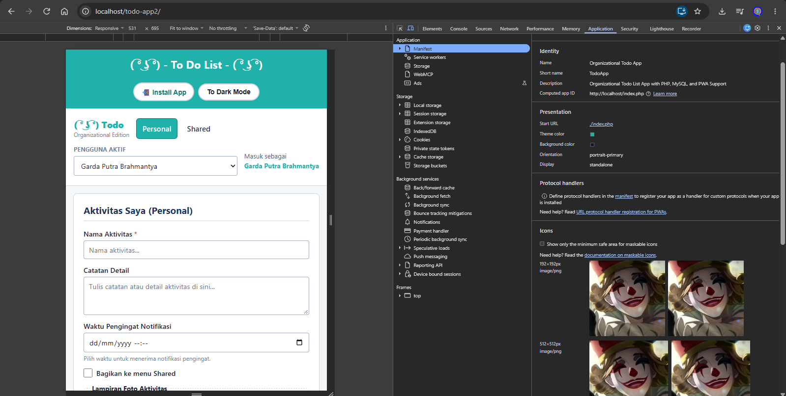
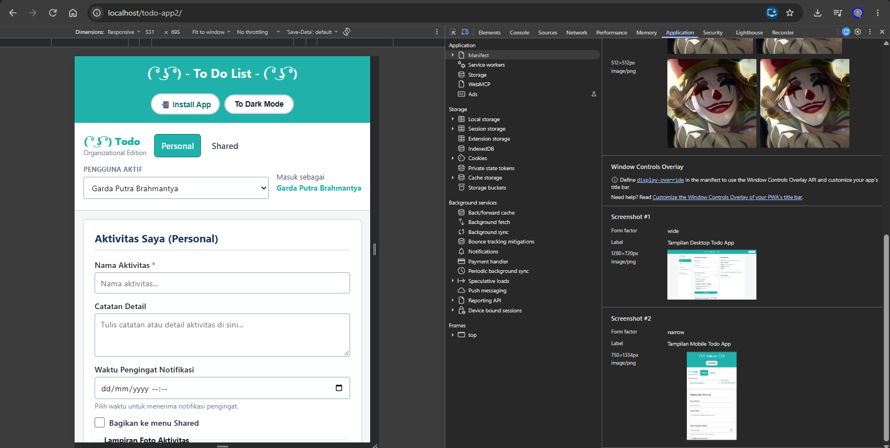
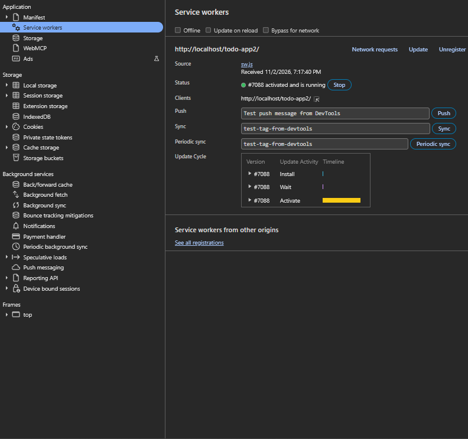
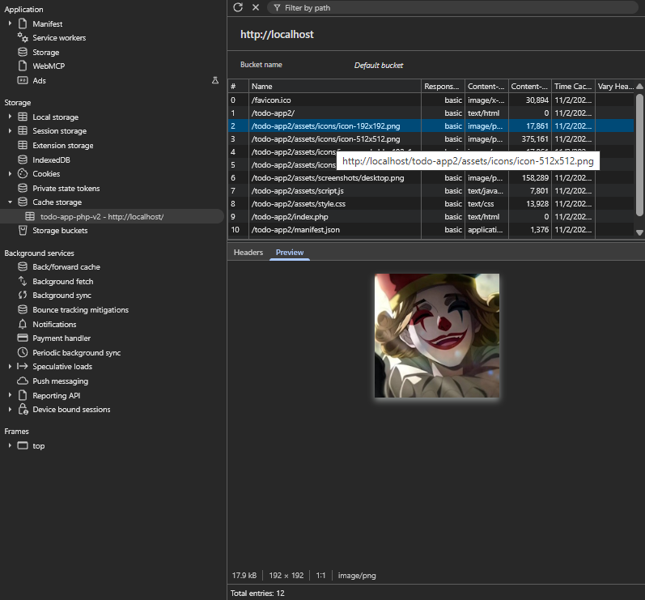
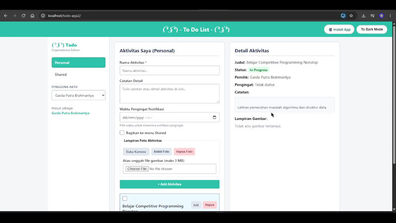
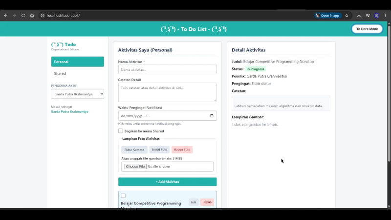

# 5025251133_Todo-App Organizational & Progressive Web App Edition

## Identitas
- **Nama** : Garda Putra Brahmantya
- **NRP** : 5025251133
- **Kelas** : Pemrograman Web - A

---

## Ringkasan Perkembangan Proyek

Aplikasi Todo List dikembangkan melalui **tiga tahap utama**:

| Tahap | Fokus | Stack Utama | Hasil |
|-------|-------|-------------|-------|
| **E03 \[The Lost Cavern\]** | Client-side modern | HTML + CSS + Vanilla JS + IndexedDB + SW | Personal todo app persisten di browser |
| **E04 \[Iron Citadel\]** | Server-side organizational | PHP 8 + MySQL + PDO | Multi-user todo app dengan menu **Personal** & **Shared** |
| **E05 \[The Offline Abyss\]** | Progressive Web App (PWA) | PWA Manifest + SW Caching Strategies + Offline Fallback | Aplikasi web yang dapat di-install & dapat digunakan tanpa koneksi internet |

Versi final = **PHP + MySQL + PWA** — mengombinasikan CRUD server-side, session-based multi-user, dan file handling PHP dengan kapabilitas *Progressive Web App* penuh (Web App Manifest, precaching *App Shell*, strategi caching khusus per *resource*, tombol instalasi PWA, serta dukungan *offline mode*).

---

## Daftar Isi

1. [Fitur Utama](#-fitur-utama)
2. [Struktur File](#-struktur-file)
3. [Struktur Database](#-struktur-database)
4. [Cara Menjalankan](#-cara-menjalankan)
5. [Penjelasan Kode per File (Detail)](#-penjelasan-kode-per-file-detail)
   - [config.php](#1-configphp)
   - [data.sql](#2-datasql)
   - [functions.php](#3-functionsphp)
   - [actions.php](#4-actionsphp)
   - [index.php](#5-indexphp)
   - [menubar.php](#6-menubarphp)
   - [content.php](#7-contentphp)
   - [manifest.json](#8-manifestjson)
   - [sw.js](#9-swjs)
   - [offline.html](#10-offlinehtml)
   - [assets/script.js](#11-assetsscriptjs)
   - [assets/style.css](#12-assetsstylecss)
6. [Dokumentasi & Bukti PWA [E05]](#-dokumentasi--bukti-pwa-e05)
7. [Perbandingan Perkembangan Proyek](#-perbandingan-perkembangan-proyek)
8. [Aksesibilitas](#-aksesibilitas)
9. [Preview & Demo (WAJIB)](#-preview--demo-wajib)
10. [Checklist Sebelum Submit](#-checklist-sebelum-submit)
11. [Link Deployment & Tech Stack](#-link-deployment--tech-stack)

---

## Fitur Utama

### Fungsional Server-Side & Organisasi
- **Sidebar navigasi** menu **Personal** / **Shared** + **user switcher**.
- **CRUD lengkap via PHP** dengan pola Post/Redirect/Get (PRG).
- **Multi-user**: Ganti user aktif dari sidebar → list Personal & hak akses berubah.
- **Shared view**: Menampilkan todo `is_shared = 1` dari **semua user**, lengkap dengan badge pemilik.
- **Otorisasi server-side**: Hanya pemilik yang dapat Edit/Hapus; user lain hanya dapat toggle status todo Shared.
- **File handling PHP**:
  - Upload berkas via `<input type="file">` (`move_uploaded_file` + `finfo` MIME validation).
  - Upload gambar dari kamera via base64 data URL (`file_put_contents`).
  - **File fisik terhapus otomatis** saat todo dihapus dari database.
- **Kamera Media Capture** (`getUserMedia` + `<canvas>`).
- **Waktu pengingat notifikasi** (`datetime-local`) + **Notification API**.
- **Dark Mode persisten** via `localStorage`.

### Fitur PWA (Progressive Web App - E05)
- **Web App Manifest (`manifest.json`)**: Memuat metadata aplikasi (`name`, `short_name`, `theme_color`, `start_url`), ikon multi-ukuran (192px, 512px, maskable), serta screenshots untuk *Richer Install UI*.
- **Precaching App Shell**: Service Worker otomatis melakukan precaching pada *App Shell* (`index.php`, `style.css`, `script.js`, `manifest.json`, ikon, dan `offline.html`).
- **Strategi Caching Khusus (Per Resource)**:
  - **Network-First**: Untuk navigasi halaman (`index.php`), dengan fallback ke cache atau `offline.html` saat sinyal putus.
  - **Stale-While-Revalidate**: Untuk aset statis (CSS, JS, Ikon) agar aplikasi dimuat secara instan dan diperbarui di latar belakang.
- **Offline Fallback Page (`offline.html`)**: Ditampilkan ketika pengguna menjelajahi halaman tanpa koneksi internet dan halaman tersebut belum tersimpan di cache.
- **Tombol Install PWA Kustom**: Tombol **📲 Install App** muncul otomatis di header melalui event `beforeinstallprompt` dan siap mengunduh aplikasi ke perangkat (Desktop/Mobile).

### Aksesibilitas (A11y)
- Landmark ARIA (`banner`, `main`, `contentinfo`).
- `aria-labelledby` panel ↔ heading.
- `aria-current="page"` pada menu aktif.
- `aria-live="polite"` detail panel + `srAnnouncement`.
- `role="status"` status completed/in-progress.
- `:focus-visible` outline tegas.
- Keyboard nav penuh.

---

## 🗂️ Struktur File

```text
5025251133_Todo-App/
├── index.php          # Controller utama, routing, & render HTML
├── config.php         # PDO Database connection, session, & upload constants
├── functions.php      # Fungsi helper CRUD, upload file, & formatting
├── actions.php        # Dispatcher POST request (Add, Update, Delete, Toggle, Switch User)
├── menubar.php        # Component Sidebar (Personal/Shared nav + User Switcher)
├── content.php        # Component Main Content (Form, List, Detail View, Edit Mode)
├── offline.html       # Fallback page saat offline tanpa cache
├── manifest.json      # Web App Manifest PWA (Metadata, Icons, Screenshots)
├── sw.js              # Service Worker (Precaching, Network-First, Stale-While-Revalidate)
├── data.sql           # Database schema DDL + Initial dummy data
├── README.md          # Dokumentasi proyek lengkap
├── assets/
│   ├── style.css      # Custom stylesheet (Light & Dark Mode, Responsive, Header Actions)
│   ├── script.js     # Client-side logic (Camera, Theme, SW registration, PWA install prompt)
│   ├── icons/         # Ikon aplikasi PWA (192x192, 512x512, maskable)
│   └── screenshots/   # Tangkapan layar bukti pengujian DevTools & PWA Richer UI
└── uploads/           # Direktori penyimpanan berkas gambar yang diunggah
```

---

## 🗄️ Struktur Database

**Database**: `todo_app` (MySQL/MariaDB, `utf8mb4_unicode_ci`)

### `users`
| Kolom | Tipe | Keterangan |
|-------|------|-----------|
| `id` | INT UNSIGNED PK AI | ID pengguna |
| `username` | VARCHAR(50) UNIQUE | Username unik |
| `display_name` | VARCHAR(100) | Nama tampilan |
| `created_at` | TIMESTAMP | Waktu pendaftaran |

### `todos`
| Kolom | Tipe | Keterangan |
|-------|------|-----------|
| `id` | INT UNSIGNED PK AI | ID todo |
| `user_id` | INT UNSIGNED FK→users.id (CASCADE) | Pemilik todo |
| `title` | VARCHAR(255) | Judul aktivitas |
| `description` | TEXT NULL | Catatan tambahan |
| `notify_time` | DATETIME NULL | Waktu pengingat notifikasi |
| `image_path` | VARCHAR(255) NULL | Path relatif gambar (`uploads/xxx.jpg`) |
| `is_completed` | TINYINT(1) | Status selesai (0 = In Progress, 1 = Completed) |
| `is_shared` | TINYINT(1) | Tipe akses (0 = Personal, 1 = Shared) |
| `created_at` / `updated_at` | TIMESTAMP | Waktu pembuatan / perubahan |

---

## 🚀 Cara Menjalankan

### Menggunakan XAMPP (Direkomendasikan)
1. **Jalankan Apache & MySQL** dari XAMPP Control Panel.
2. Salin folder proyek ke lokasi `C:\xampp\htdocs\5025251133_Todo-App\`.
3. Buka phpMyAdmin di `http://localhost/phpmyadmin/` → Buat/Pilih database `todo_app` → tab **Import** → impor berkas `data.sql`.
4. Pastikan kredensial di `config.php` sudah sesuai (`DB_HOST` = `localhost`, `DB_USER` = `root`, `DB_PASS` = `""`).
5. Buka aplikasi pada browser via:
   ```text
   http://localhost/5025251133_Todo-App/
   ```
6. Izinkan notifikasi & kamera saat diminta oleh browser.

> ⚠️ **Catatan PWA & Secure Context**: Service Worker dan Instalasi PWA hanya dapat berjalan pada *Secure Context* (`https://` atau `http://localhost`).

---

## 🔍 Penjelasan Kode per File (Detail)

### 1. `config.php`
Menangani sesi pengguna, konstanta direktori pengunggahan, dan inisialisasi koneksi database PDO dengan *Prepared Statements* asli.

```php
define('UPLOAD_DIR', __DIR__ . '/uploads/');
define('UPLOAD_URL', 'uploads/');
define('MAX_UPLOAD_BYTES', 3 * 1024 * 1024); // 3 MB

$pdo = new PDO(
    'mysql:host=' . DB_HOST . ';dbname=' . DB_NAME . ';charset=utf8mb4',
    DB_USER, DB_PASS,
    [
        PDO::ATTR_ERRMODE            => PDO::ERRMODE_EXCEPTION,
        PDO::ATTR_DEFAULT_FETCH_MODE => PDO::FETCH_ASSOC,
        PDO::ATTR_EMULATE_PREPARES   => false,
    ]
);
```

### 2. `data.sql`
Skema DDL MySQL lengkap dengan tabel `users` & `todos`, relasi *Foreign Key* `ON DELETE CASCADE`, serta dummy data untuk pengujian multi-user.

### 3. `functions.php`
Berisi seluruh fungsi bisnis logika CRUD, manipulasi data `normalizeDateTime()`, pemformatan tampilan, otorisasi, dan penanganan file upload:
- `handleImageUpload()`: Mengunci pengunggahan file dari `<input type="file">` (validasi MIME `finfo`) maupun tangkapan kamera Base64 (`file_put_contents`).
- `deleteTodoWithImage()`: Menghapus baris todo di MySQL sekaligus **membersihkan berkas gambar fisik** dari folder `uploads/`.

### 4. `actions.php`
Dispatcher POST request utama yang menerapkan otorisasi server-side dan skema *Post/Redirect/Get* (PRG) untuk mencegah submit ganda.

### 5. `index.php`
Controller dan titik masuk utama halaman. Berfungsi meng-include file konfigurasi, memproses routing `?view=personal|shared`, menghubungkan `<link rel="manifest" href="manifest.json">`, mendaftarkan pemicu PWA, serta me-render UI utama.

### 6. `menubar.php`
Komponen navigasi sidebar yang menampilkan menu Personal & Shared serta form *User Switcher* untuk berganti sesi pengguna aktif secara mudah.

### 7. `content.php`
Komponen penyusun form tambah todo (lengkap dengan modul kamera & file upload), daftar todo dengan checkbox auto-submit, badge pemilik di Shared view, serta panel detail/edit todo.

### 8. `manifest.json`
Web App Manifest yang mengonfigurasi identitas PWA, `start_url`, warna tema, ikon (192px, 512px, maskable), serta screenshots untuk dukungan *Richer PWA Install UI*.

### 9. `sw.js`
Service Worker aplikasi yang menerapkan caching strategi ganda:
- **Pre-caching**: Menyimpan aset utama *App Shell* saat event `install`.
- **Network-First**: Untuk permintaan navigasi HTML (`index.php`), dengan fallback cache / `offline.html`.
- **Stale-While-Revalidate**: Untuk static assets (CSS, JS, Ikon).

### 10. `offline.html`
Halaman cadangan (*offline fallback page*) berpola UI kegelapan (*The Offline Abyss*) yang ditampilkan Service Worker ketika perangkat tidak memiliki jaringan internet dan halaman belum pernah tersimpan di cache.

### 11. `assets/script.js`
Menangani inisialisasi client-side:
- Dark mode toggle dengan penyimpanan `localStorage`.
- Media Capture API (Kamera `<video>` dan `<canvas>` snapshot ke input hidden).
- Pendaftaran Service Worker (`navigator.serviceWorker.register`).
- **PWA Install Prompt Listener**: Menangkap `beforeinstallprompt` untuk menampilkan tombol **📲 Install App**.

### 12. `assets/style.css`
Style sheet utama aplikasi yang mencakup layout responsive Flexbox, variabel tema gelap/terang, styling tombol header pwa install, serta komponen UI aksesibel.

---

## 📱 Dokumentasi [E05]

Pengujian fitur Progressive Web App [E05] dilakukan menggunakan **Chrome DevTools** pada *tab Application & Network* untuk membuktikan pemenuhan tugas nomor 1 sampai 5.

### 1. Web App Manifest (`manifest.json`)
Web App Manifest terdeteksi tanpa error. Seluruh properti identitas aplikasi, warna tema, ikon (192px, 512px, maskable), dan *screenshots* Richer UI terkonfigurasi dengan tepat.



### 2. Service Worker Active (`sw.js`)
Service Worker terdaftar pada *scope* aplikasi dan berstatus hijau **`Activated and is running`**.


### 3. Cache Storage (Precache App Shell)
Seluruh berkas utama *App Shell* (`index.php`, `offline.html`, `manifest.json`, `style.css`, `script.js`, dan ikon) berhasil tersimpan di dalam Cache Storage (`todo-app-php-v3`).


### 4. Tombol Install PWA & Prompt Installation
Tombol **📲 Install App** pada header aplikasi aktif melalui event `beforeinstallprompt` dan berhasil memicu jendela instalasi PWA native browser saat diklik.


### 5. Pengujian Offline Mode (Network Off Test)
Saat jaringan disimulasikan **Offline** melalui tab DevTools Network, aplikasi tetap dapat diakses dengan lancar dari *Cache Storage*, serta menampilkan halaman fallback `offline.html` saat navigasi dilakukan tanpa sinyal.


---

## 🔄 Perbandingan Perkembangan Proyek

| Fitur / Aspek | E03 — Lost Cavern | Iron Citadel | E05 — The Offline Abyss (Final) |
|---------------|-------------------|--------------|--------------------------------|
| **Arsitektur** | Single Page App (JS) | PHP Modular Server-side | **PHP Server-Side + PWA Client** |
| **Penyimpanan Data** | IndexedDB | MySQL / MariaDB | **MySQL (Online) + Cache Storage (Offline)** |
| **Identitas App** | Standard HTML | Standard HTML | **Web App Manifest (`manifest.json`)** |
| **Akses Offline** | Basic Cache | Offline terbatas | **Full PWA Offline Mode + Fallback Page** |
| **Instalasi App** | Manual Browser | Tidak Ada | **Tombol Install PWA (Native Prompt)** |
| **Caching Strategy**| Basic Precaching | Non-PWA | **Network-First + Stale-While-Revalidate** |
| **Multi-User & Access**| Single-user | Multi-user Session | **Multi-user Session & Authorization** |
| **File Handling** | Base64 Client | PHP Upload + Cleanup | **PHP Upload + Cleanup + SW Cache** |

---

## ♿ Aksesibilitas

| Elemen | Implementasi |
|--------|--------------|
| Landmark ARIA | `role="banner"`, `role="main"`, `role="contentinfo"` |
| Binding Panel | `aria-labelledby="headingList"` & `"headingDetail"` |
| Navigasi Aktif | `aria-current="page"` |
| Pengumuman Live | `aria-live="polite"` pada panel detail dan `srAnnouncement` |
| Indikator Status | `role="status"` pada badge In Progress / Completed |
| Interactive Buttons | `aria-pressed` & `aria-label` dinamis pada tombol Dark Mode & Install |
| Focus Indicator | Outline tegas `:focus-visible { outline: 3px solid #3182ce; }` |

---

## 🎬 Preview & Demo (WAJIB)

### 🖼️ A. Tangkapan Layar Statis (PNG)

| # | File Berkas | Deskripsi Tampilan | Fitur Terkait |
|---|-------------|--------------------|---------------|
| 1 | `assets/01-project-structure.png` | Struktur folder proyek di VS Code | Arsitektur PHP & PWA |
| 2 | `assets/02-data-sql.png` | Isi berkas `data.sql` (DDL & DML) | MySQL Database Schema |
| 3 | `assets/03-phpmyadmin-structure.png` | Struktur tabel `todos` di phpMyAdmin | Database Relation |
| 4 | `assets/04-pwa-manifest.png` | Panel DevTools Manifest terdeteksi hijau | PWA Manifest (E05 #1) |
| 5 | `assets/05-pwa-serviceworker.png` | Status Service Worker Activated & Running | Service Worker (E05 #2) |
| 6 | `assets/06-pwa-cache-storage.png` | Daftar aset App Shell di Cache Storage | Cache Strategy (E05 #3) |
| 7 | `assets/07-pwa-install-prompt.png` | Jendela prompt instalasi PWA aktif | Install Button (E05 #4) |
| 8 | `assets/08-pwa-offline-test.png` | Halaman dimuat sukses dalam kondisi Network Off | Offline Test (E05 #5) |
| 9 | `assets/09-desktop-dark.png` | Tampilan Desktop Dark Mode halaman Personal | UI & Accessibility |
| 10 | `assets/10-mobile-view.png` | Responsive view 375px mobile mode | Responsive Layout |

---

## 🔗 Tech Stack


- **Backend & Database**: PHP 8.2+, MySQL / MariaDB (PDO Prepared Statements)
- **Frontend & PWA**: HTML5, CSS3, Vanilla JS, Service Workers, Web App Manifest
- **Media API**: Media Capture and Streams API (`getUserMedia` + `<canvas>`), Notification API

---

_README versi 3.0 (E05 Progressive Web App Complete) · Terakhir diperbarui: 2026-11-02 · Garda Putra Brahmantya (5025251133)_
